## Overview

Dealfront helps B2B teams find companies and reach them. The Company Profile is where you land after you find a lead. The lead can come from a prospecting list or from a visit to your website. The profile opens as a panel next to your list of companies.

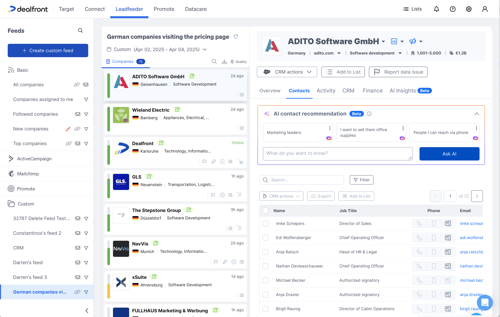
<figcaption>The final state of the project.</figcaption>

The data on every tab is real and useful, but our dataset is massive. That was what made it hard to read. From here on the screens show only the profile panel, because that is where the work happened.

## The problem

Two tabs were overloaded. The third job had no tab at all.

-   **Activity.** Every visit and every page, with the source, device and location attached. Real buying behaviour sits in there. A person who spends eight minutes on pricing and product pages is a different lead from a person who leaves a blog post after ten seconds. To see that, you had to read the whole log, line by line. The log is long, and it grows every day.
-   **Contacts.** Hundreds of people at one company. The right person to call changes with what you sell. If you sell office supplies, you want operations. If you sell an AI platform, you want the person who drives adoption. No column in the table tells you that.
-   **The company itself.** News, competitors, market position, recent events. That research happened in another browser tab, on Google. Whatever you found stayed there.

On Activity and Contacts the data was all there, just unsorted. You could not tell the useful visits from the noise without reading everything. That reading was manual work, and it fell on people who were hired to sell.

## Round one: let people ask

The AI itself wasn't new. The backend, the model calls, the guardrails on context and permissions, the safety checks, had already been built and tested elsewhere in the company. What was missing was a way to use it. Dealfront set aside a couple of weeks for teams across the company to build on top of it. This is the Company Profile team's slice of it.

The first round went from zero to shipped in a week. Research, design and testing ran side by side, not one after another. PMs, CS reps, clients, and even the C-level were interviewed all through the project, not just before it started. We had a very basic first draft by Tuesday: no text input yet, just enough to test the idea. Through the week we moved from no questions to letting people ask their own, refined it against what we heard, and handed it to the dev team on Friday.

‍

### The version we got wrong first

The first designs gave you one button. Press Generate, the AI reads the whole activity log, and a summary appears. No work for you.

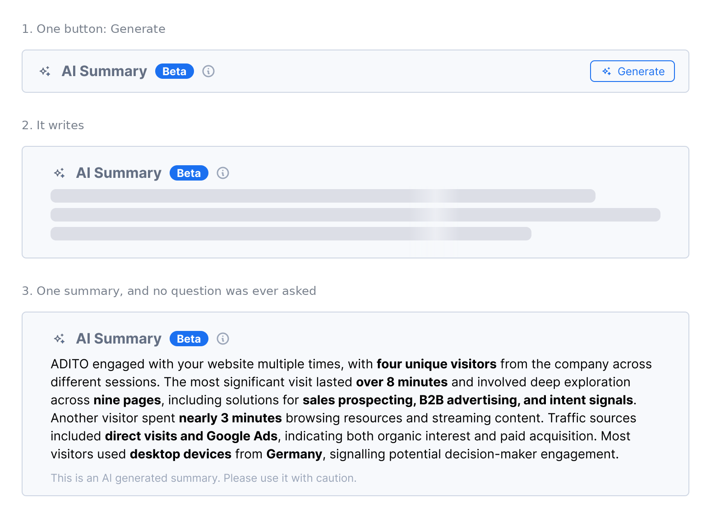
<figcaption>The whole flow of the design we dropped.</figcaption>

There is one button, and no way to steer what comes back.

We showed it to internal users and to a few real users we booked in the same week. They all pushed back on the same thing. The summary was fine, but it was not what they would have asked. One person wants buying signals. The next wants to know who to call. One automatic answer serves none of them well.

They wanted control: their own questions, and a way to keep them. That changed the shape of the project, and we built the design around asking. We also added pinning. If a question is good for one company, it is good for the next hundred, so you keep it and reuse it.

### Question cards instead of an empty box

An empty chat box asks you to invent the right question. Most people will not. The ones who try often give up after one bad answer.

So every AI block opens with question cards. Real questions, already written, that run in one click. We wrote them from the interviews and from what the team already knew. A free text field sits underneath, for anyone who wants it.

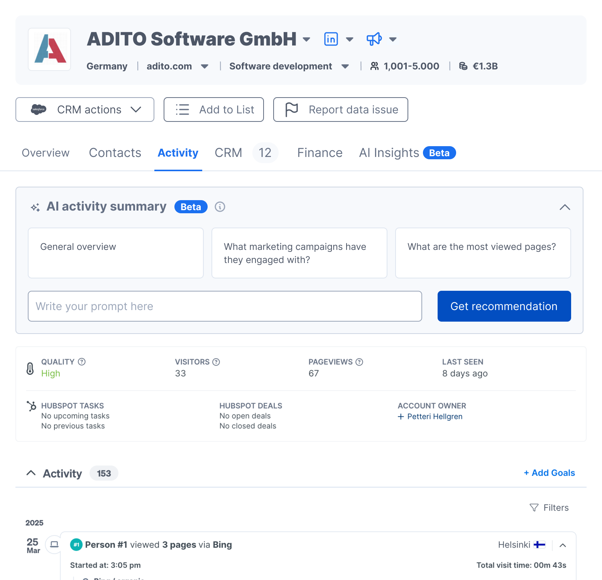
<figcaption>The way in is a question someone already wanted to ask.</figcaption>

### The Contacts questions return names

Every card on Contacts is written to come back with people at that company. We shaped them that way so the answer could reach the table.

Once the AI names people, the table has something to act on.

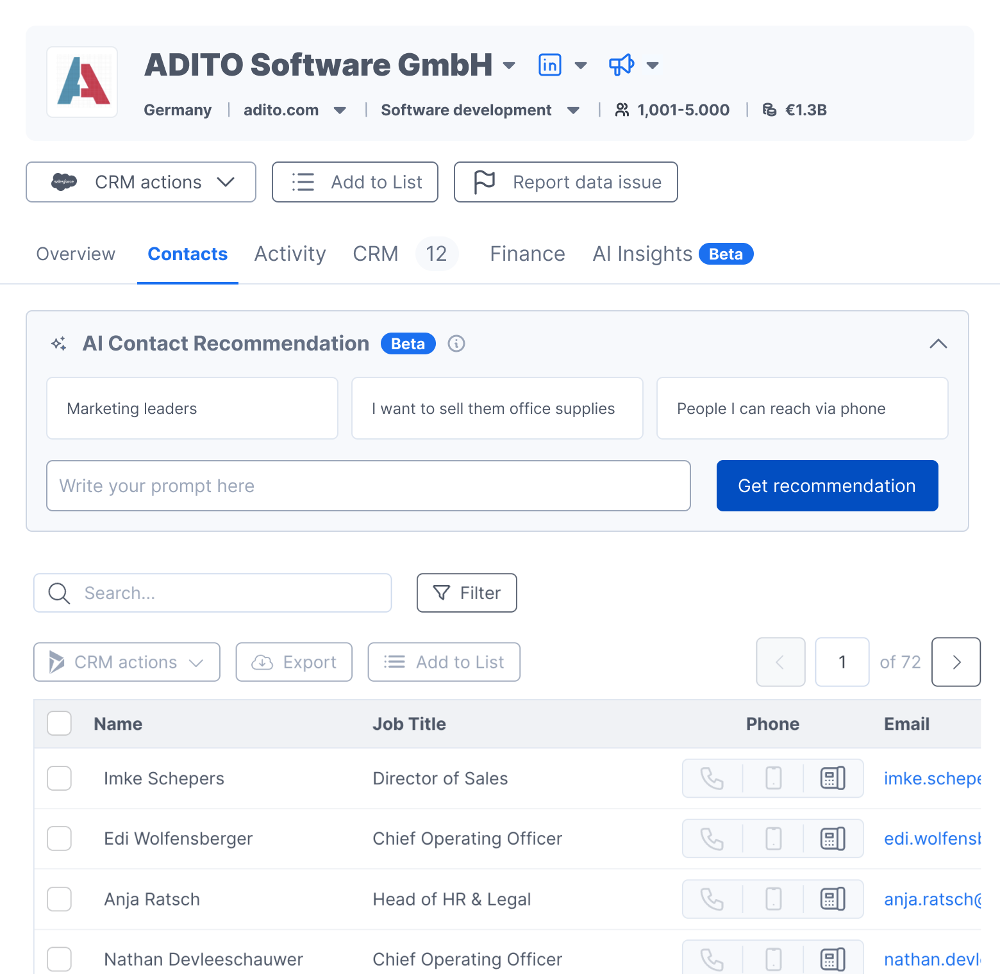
<figcaption>Questions written the way a salesperson thinks about a deal.</figcaption>

### The answer lands next to the data

I tried two ways to connect an answer back to the table it came from. The first put an AI icon on the recommended rows. You hover over the icon to read why that person was picked.

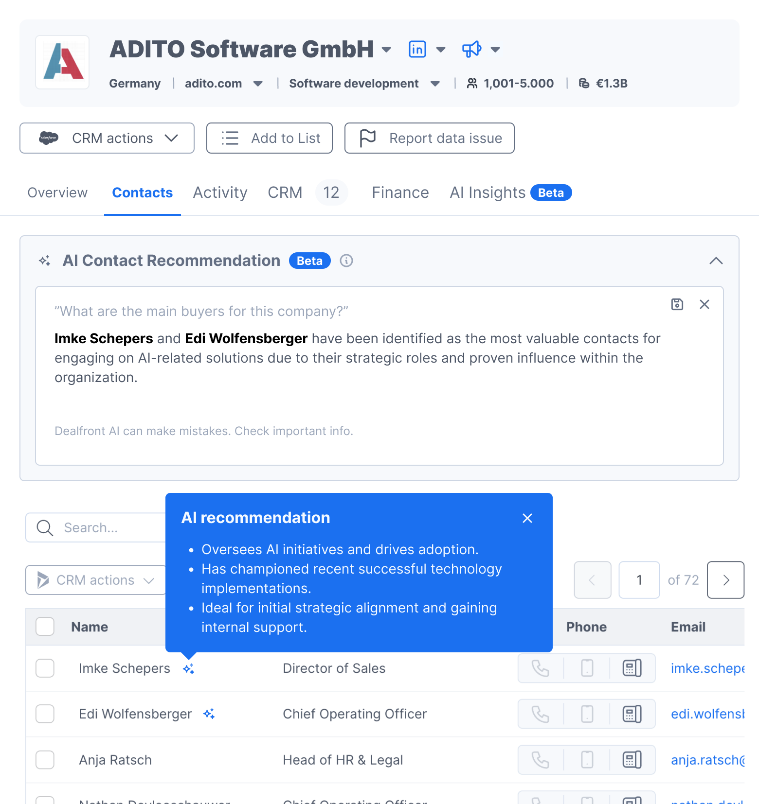
<figcaption>One we dropped: the AI marks people in the table, and you hover to find out why.</figcaption>

The second added a toggle that filters the table down to the recommended people. Turn it on and only those people show. Turn it off and everyone comes back.

Filtering won. The icon was easy to miss in a long table. The reason sat behind a hover, so it never reached keyboard or touch users. The toggle is visible and it says what it does.

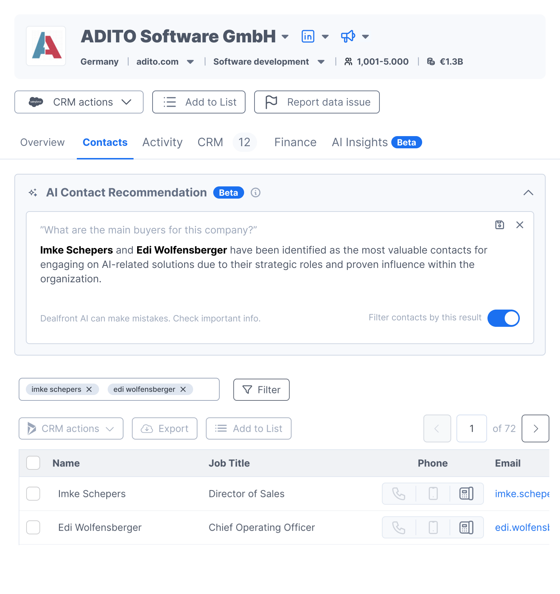
<figcaption>You can see it, and you can undo it.</figcaption>

### One pattern, three places

Activity and Contacts run the same block. Only the title and the questions change, because each one is tied to the data on its tab. On Activity, it reads the activity log. On Contacts, it reads the people at that company.

AI Insights takes any question about the company. It answers from whatever it can use: Dealfront's own data, or material from outside like the company's website, news coverage and official announcements. Since it is so broad, it was placed on its own tab.

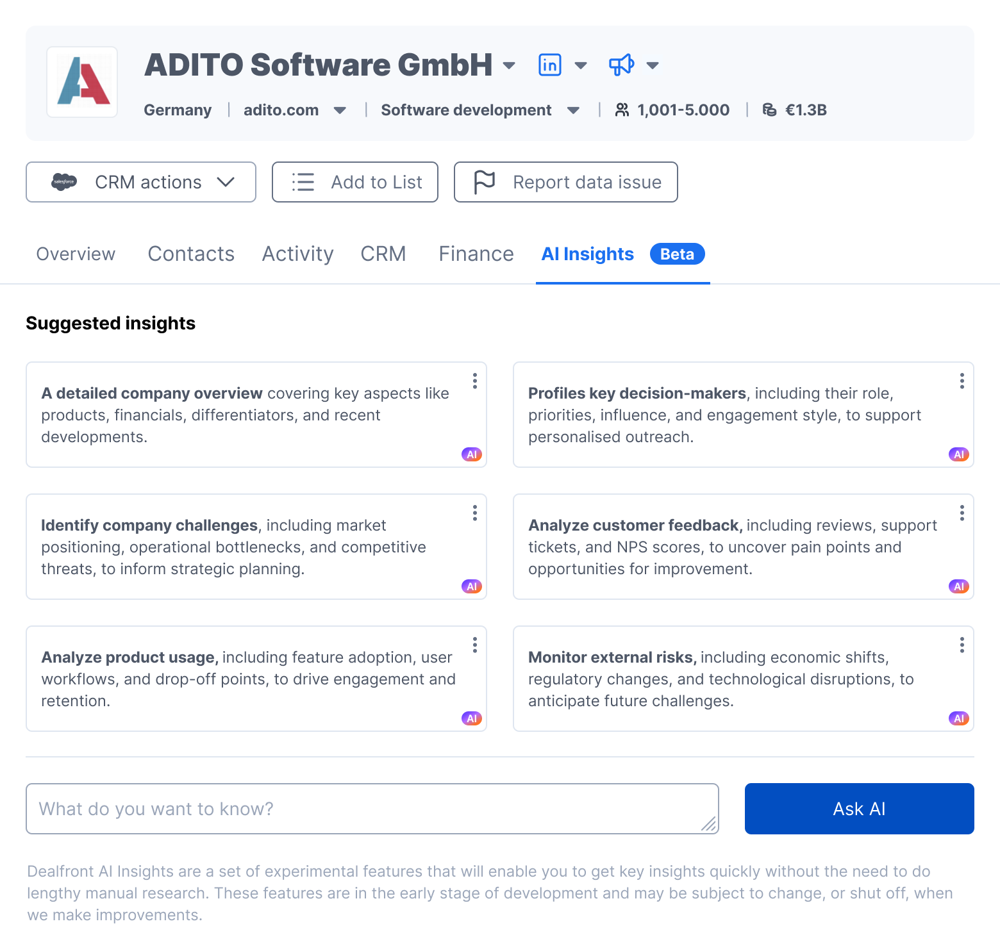
<figcaption>It can answer any question about the company, so it got the whole tab.</figcaption>

## Round two: earning trust

A week later we went back in. Two things drove it.

**Dealfront was shipping AI in more than one place.** Lists Enrichment and Alerts were building their own AI features, each with its own look. Three teams were each inventing their own AI language. The Company Profile had to stop being an island and join a house pattern: the purple accent, the sparkle icon, lighter surfaces instead of the grey panel, and example prompts instead of an empty field.

**Real use showed what was missing.** You could not see where an answer came from, and you could not tell us when one was wrong.

### Sharing space

The Activity tab already had four filter dropdowns above the activity log. We put the AI block on top of that, and the activity log dropped even more. So we turned AI summary and Filter into two buttons that share the same space. The activity log stays near the top, and AI summary is labelled where you cannot miss it. The tab opens with the AI Summary already open, in the collapsed state.

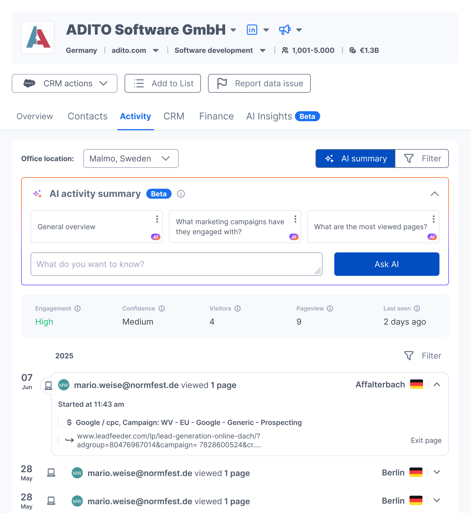
<figcaption>AI summary is open here. Click Filter and the filters take its place.</figcaption>

### Showing the work

Answers stopped being a wall of text. They come back in numbered sections, and each section says where it read.

The answer depends on what the AI is reading. On Activity and Contacts, the AI reads data Dealfront already holds: the visits, the sessions, the pages, the people at that company. There is nothing to link to, because we are the source. So those answers carry no links.

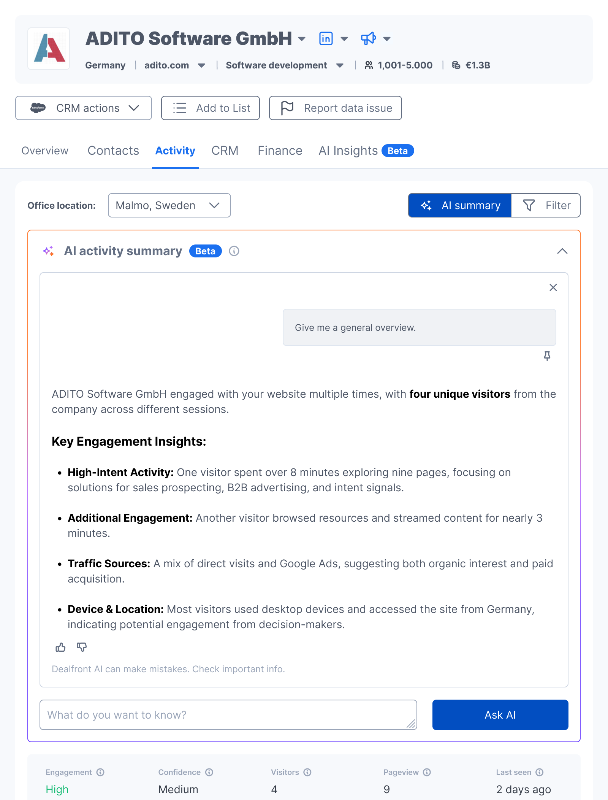
<figcaption>On Activity there are no links, because the data is ours.</figcaption>

AI Insights is broader, and it can also reach the outside world: news, filings, market position, new hires. Claims that come from outside carry a Source link you can open. When it finds nothing, it says so.

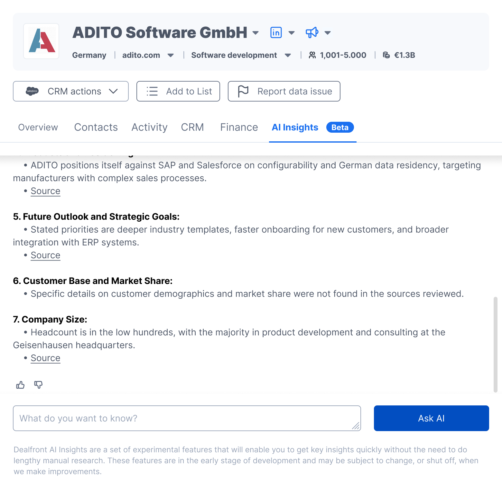
<figcaption>On AI Insights the claims carry links, because the material came from outside.</figcaption>

This is an addition that I really defended. Round one shipped with a line that says the AI can make mistakes, so check important info. That sentence hands you the work and no way to do it. Naming the material is the same honesty, made useful. That includes saying plainly when the source is us.

### The same change on Contacts

Contacts got the same treatment in the same round: the new block, the question shown above the answer, and thumbs to rate it. The filter toggle stayed where it was, because it already worked.

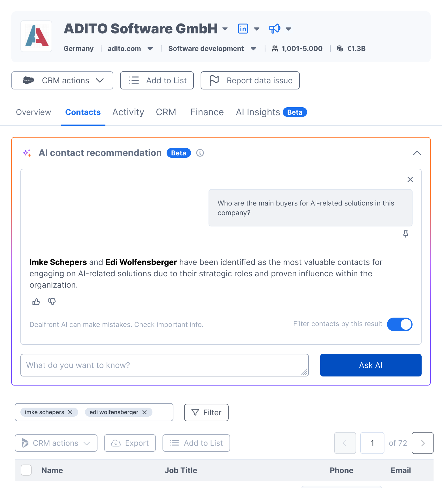
<figcaption>Contacts tab new design.</figcaption>

### A pinned question has two parts

A pinned question holds a title and a prompt. The prompt is the full request sent to the AI. The title is the short label you read on the card. Prompts get long and specific. A card is small, and you scan it in a second.

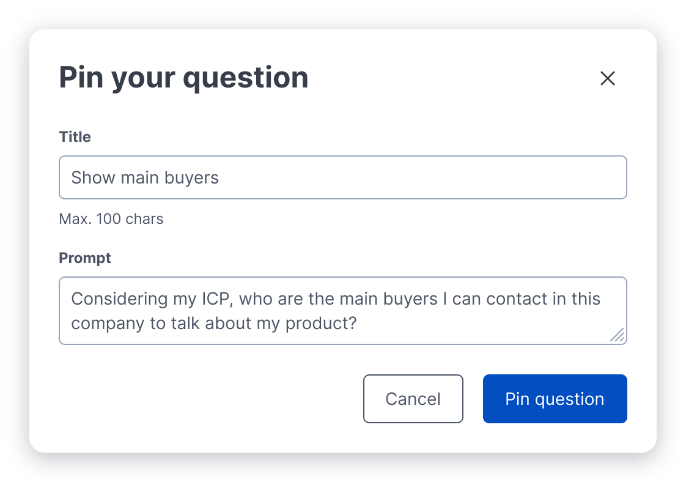
<figcaption>You write the prompt once. After that you only read the title.</figcaption>

### Nine cards, then Show all

Pinning creates its own problem. A heavy user pins twenty questions. Twenty cards would push the table off the screen.

So the block shows nine cards. At ten or more, a Show all link appears and opens the full set.

A new block on Activity or Contacts starts with three questions we wrote, the same way as round one. Those two share their tab with an activity log or a table, so three is what fits. They are only a starting point. You can delete them, and your own pins take their place.

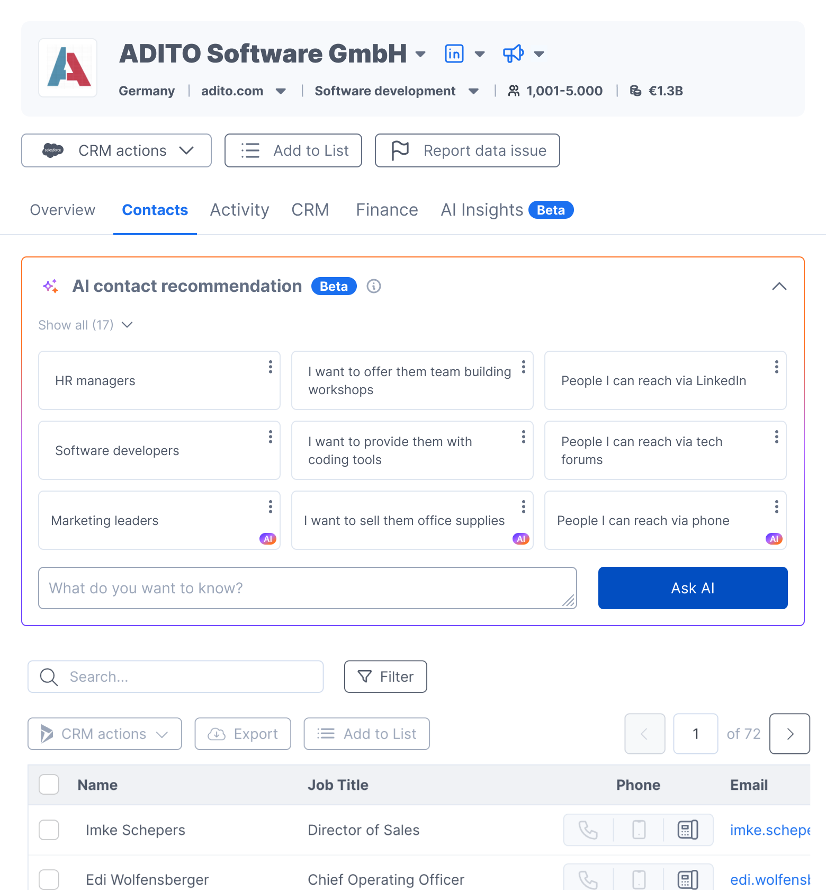
<figcaption>Nine cards fit. The rest sit behind one link.</figcaption>

### Editing, and where we drew the line

You can edit a pinned question. Open the card, change the title or the prompt, then save. The pin updates.

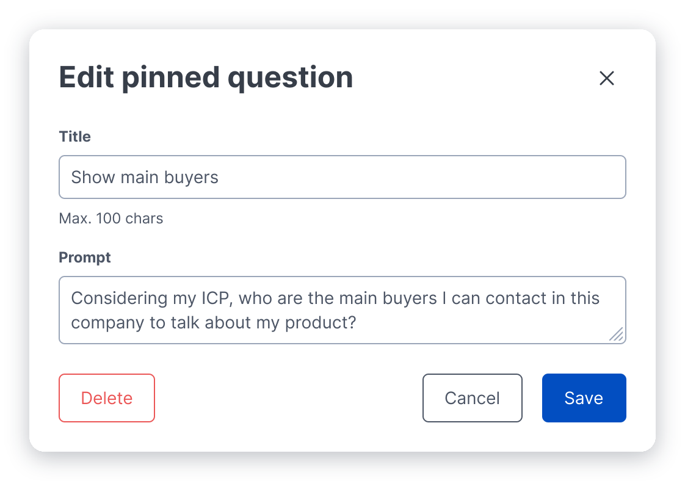
<figcaption>The same two fields, opened from a card you already pinned.</figcaption>

You cannot edit a question you already asked and run it again. Claude and ChatGPT both do this, and it is the obvious thing to reach for when an answer misses.

We left it out. Re-running an edited question needs its own states and its own history, and this was an MVP. The way around it costs a few seconds: ask again. The cards are one click, and the field is always there.

Editing a pinned question earned the build, because you reuse a pin many times. A one-off you can repeat in one click, so it went to the bottom of the list and stayed there.

### Closing the loop

Thumbs up and thumbs down joined pin and dismiss. In a beta you do not know yet whether the answers are any good. The people reading them do.

### The border is the signature

The outline animates once when you open the tab, for about a second, and then it sits still. Before you read a word, you know which block is the AI. It only has that job where the AI sits in a tab of ordinary data, so the AI Insights tab goes without one.

While the AI works, the block says what it is reading. On Activity, it reads the activity log. On Contacts, it reads the contact list. Round one showed a grey skeleton, which told you to wait without saying what for.

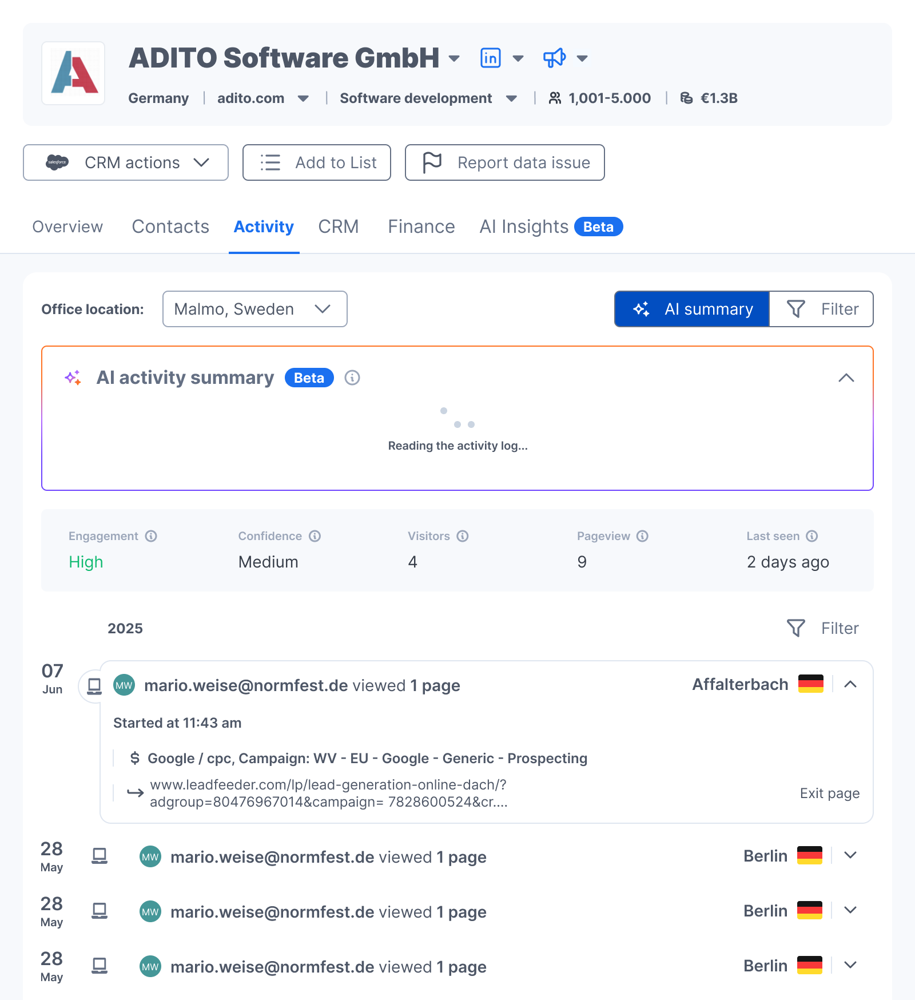
<figcaption>The outline, while the AI reads the data.</figcaption>

## Outcome

Both rounds shipped, in beta, inside two weeks. People asked questions. They pinned them too, which is the harder thing to get people to do. That was the behaviour the whole design was built around.

I stayed a few more weeks after round two, long enough to see that behaviour hold in the short term. What I don't know is whether it held over time. I left before I could see that.

‍

## Try it yourself

This isn't the real Dealfront product - it's a recreation I built with AI from the Figma files and the shipped screens, so you can use the design instead of reading about it. Ask one of the pinned questions, or type your own. Turn an answer into a filter on the table underneath. Keep the conversation going, and pin anything worth asking twice. A guided tour opens on its own and walks through the decisions this case study is about; close it and the rest is yours to poke at.

<!-- Dealfront — AI in the Company Profile. The "Try it yourself" embed.
     Paste this whole file into a CUSTOM CODE block inside the project's CMS
     rich-text field, directly under the "Try it yourself" paragraph. Nothing
     else in Webflow changes: no Designer work, no page custom code, no
     template edit. To remove it, delete the block.
     Source of truth: webflow/embed.html in the project repo. Edit it there.
-->

  

    <iframe id="dfa-frame"
            src="https://dealfront-ai-company-profile.netlify.app"
            title="AI in the Company Profile — interactive replica"
            loading="lazy" allowfullscreen
            style="width:1400px;height:900px;border:0;display:block;transform-origin:top left"></iframe>
  

  

    A guided tour opens on its own; the pill at the bottom right runs it again.
    <a href="https://dealfront-ai-company-profile.netlify.app" target="_blank" rel="noopener"
       style="color:#1b70f0;font-weight:500">Open full screen &#8599;</a>
  

