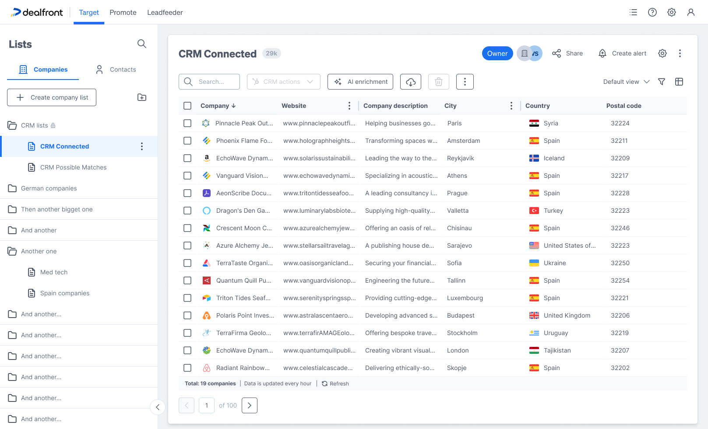
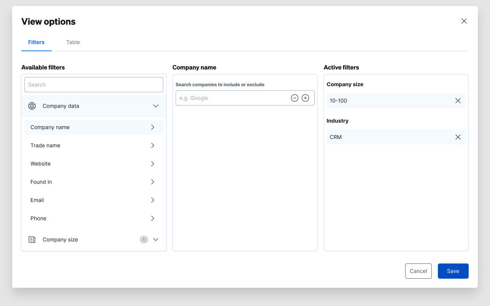
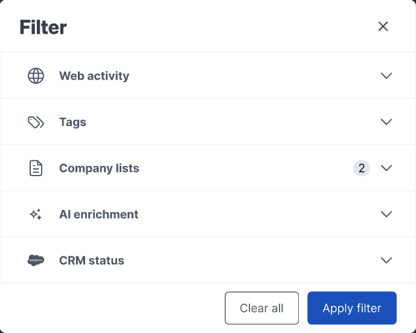
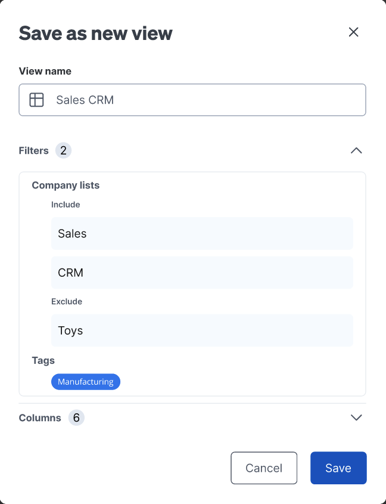
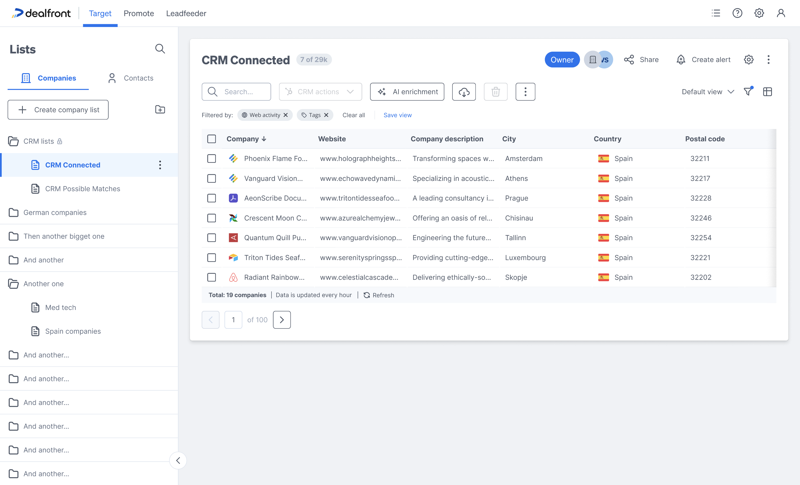
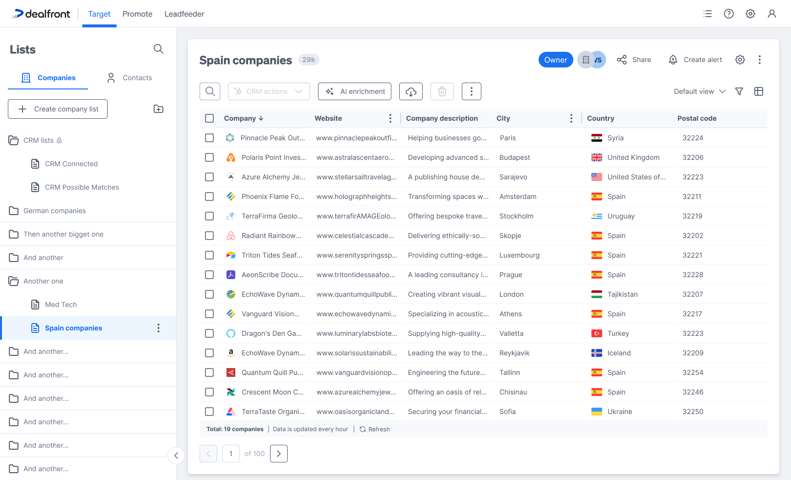

## Overview

Dealfront is a platform that helps B2B teams find and reach companies. Inside Dealfront's Target product, Lists is where everything lives: lists built from criteria, lists synced from a CRM, and lists built by hand. Lists feed everything else - exports, alerts, ad campaigns, LinkedIn audiences.

A dynamic list makes a promise: set your criteria once, and the list stays current. It updates every hour as new companies match.

<figcaption>The final design: one list, with everything that defines a view grouped on the right of the toolbar.</figcaption>

## The Problem

But the promise broke one level down. Say a user has a MedTech list. Inside it, they think in smaller groups:

-   MedTech companies with a **low engagement score** - cold leads that need follow-up
-   MedTech companies tagged **Manufacturing** - a smaller group ready for a campaign

Before this project, making one of these groups meant creating a whole new list. That caused three problems:

-   **Duplicated work.** The new list had to repeat the original criteria, plus the new group's criteria. Change the definition of MedTech, and the copies don't update.
-   **Lists that stop matching.** Each list updated on its own, so over time they didn't agree with each other anymore. Which one is correct?
-   **Too many lists.** Sidebars filled up with near-identical lists. Finding anything got harder as more people used it.

The real insight: users didn't want more lists. They wanted more ways to look at one list.

### Exploration: where do filters live?

This came down to one big question, and I explored three possible answers:

-   **A new list every time** - this was already the problem, so not a real option.
-   **Views shared across all lists** - one saved filter, reused anywhere. But a group like "low engagement" only makes sense next to its own list. Sharing views across lists breaks that connection.
-   **Views that belong to one list** - saved setups that live inside their own list. This is what we chose. The list stays the source of truth, and every view simply looks at it differently.

At the same time, I explored where the filtering controls should live: in the sidebar, in a flyout, in a popup, in a side panel, and in a tabbed "View options" modal that kept growing wider - trying to fit filters and table setup into one place.

‍

<figcaption>One of the roads not taken: a tabbed "View options" modal trying to hold filters and table setup in one surface.</figcaption>

The turning point was realizing filters and columns aren't really two things. Together, they answer one question: what am I looking at? Which companies, and what do I see about them. That's one idea - and the final design shows it clearly, right when it matters most.

### The Design

#### Filtering, kept simple

Clicking the filter icon opens a clean Filter window. Each category - web activity, tags, company lists (include and exclude), AI data, CRM status - opens on its own, with a number showing how many filters are active. Clear all and Apply filter close the loop. Once applied, the filters show up as chips under the toolbar, so you can always see what's active.

<figcaption>The Filter modal: one category open at a time, counts always visible.</figcaption>

### The moment a filter becomes a view

Filters and columns come together at exactly the right moment: when you save. The "Save as new view" window asks for a name, and shows exactly what the view will save - the filters and the columns, together, each with a count. That's the idea made visible: a view is which companies, plus what you see about them, saved as one thing.

<figcaption>Save as new view: the modal shows what a view really is - filters and columns, captured together.</figcaption>

### State that's always honest

For this to work, users need to always know what they're looking at. Three small details make that possible:

-   **The "Filtered by" row** under the toolbar. Every active filter shows as a chip you can remove, with Clear all and Save view right there. The moment a filter feels worth keeping, saving it is one click away.
-   **A dot on the filter icon** when filters are active but the window is closed. So the state is never hidden just because the window is.
-   **A "modified" flag** on the view selector. Change a saved view, and it tells you - with options to save as new or revert. One clear rule: clicking "Default view" clears everything. There's always an easy way back, and the default view is never overwritten by accident.

<figcaption>Applied filters stay visible as chips, with Save view exactly where the decision happens.</figcaption>

### The dynamic part stays visible

A small line in the footer does a lot of work: "Total: 19 companies · Data is updated every hour · Refresh." It's a small reminder, but it's how people learn - and keep trusting - that the list is alive underneath their views.

## Outcome

Here's what changed for the MedTech user: one list, one set of criteria, and views for "Low engagement" and "Manufacturing" that always match the original - because they're not copies, they're the same list, seen differently. No duplicated work, no drift, and the sidebar stays easy to use.

‍

<figcaption>The same pattern, on any list: views scoped to their source, with the sidebar staying navigable.</figcaption>

The idea also proved useful elsewhere. Views gave alerts and workflows something precise to point to - "notify me when a company enters this view" - so the feature grew past what it was built for.

## Try it yourself

This isn't the real Dealfront product - it's a faithful recreation I built with AI, based on the actual Figma files and shipped screens (plus some optimizations), to let you interact with the design instead of just reading about it. Filter the list, customize and reorder columns, save views, switch between them, watch the modified state appear. A guided tour walks through the design decisions, or you can just play.

  

    <iframe id="dfl-frame" src="https://dealfront-dynamic-lists-cd-7c276e015d.netlify.app" title="Dynamic Lists interactive replica" loading="lazy" allowfullscreen style="width:1400px;height:900px;border:none;display:block;transform-origin:top left;"></iframe>
  

  
Shown scaled to fit - fully interactive, but easier at full size. <a href="https://dealfront-dynamic-lists-cd-7c276e015d.netlify.app" target="_blank" rel="noopener" style="color:#1b70f0;font-weight:500;">Open full screen ↗</a>

