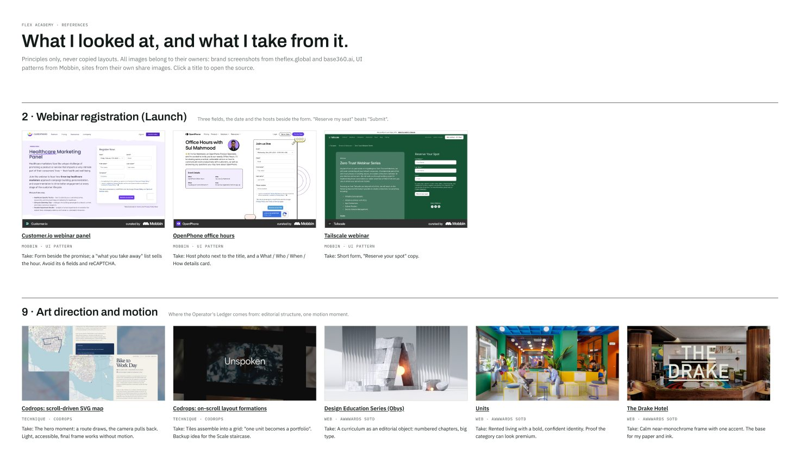
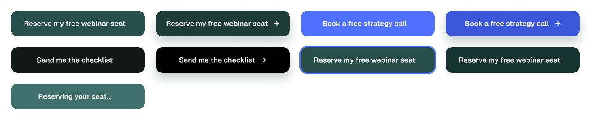
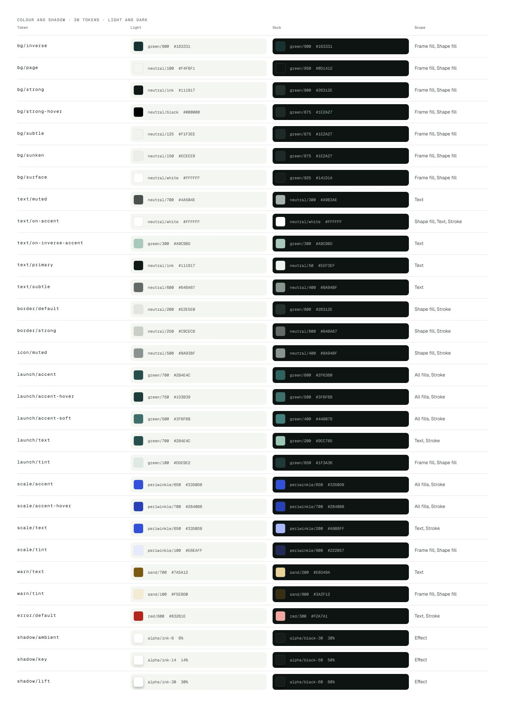

 

## The brief

The Flex runs furnished apartments in seven cities. Its founders also built Base360, the software behind those apartments. Flex Academy is their next company: it teaches the playbook. It sells two programmes. **Launch** is for beginners and starts with a free webinar. **Scale** is for operators who already run units and starts with a strategy call.

The brief set three tests for the page:

-   **5 seconds:** a visitor knows who it is for and what they get.
-   **30 seconds:** the visitor trusts it.
-   **Any point of the scroll:** the visitor can act without searching.

The hard part was trust. Both readers are tired of "guru" courses, and a new company has no students and no reviews yet.

## How I ran it

Before any pixels, I wrote down the two jobs the page has to do. Same page, very different readers:

-   **Starting out:** "When I think about leaving my 9-to-5, I want to see a real path to my first unit, so I can decide if this is for me without risking money."
-   **Already running units:** "When my units start running my week, I want systems and people who did it before, so I can grow without burning out."

Then I set four principles. They were the review criteria for every direction and every section:

-   **Proof, not promises.** Only facts I can source. No income claims, no countdowns, no fake testimonials.
-   **One page, two readers.** Every section works for both, or switches cleanly between them.
-   **Action always in reach.** At any point of the scroll, the next step is one click away.
-   **Accessible by default.** WCAG 2.1 AA is part of done, checked by a machine, not by hope.

Below is what I did alone in the timebox. Switch to the team view to see how I would run the same steps as a lead, with a PM, an engineer and a researcher.

## Research: real facts, real references

I started with the two parent brands. I went through theflex.global and base360.ai: colours, type, photos, voice, and every fact they state in public. That gave me a fact bank and a hard rule: the page only uses facts I can source.

Then I collected 45 references: booking and webinar flows from Mobbin, plus education, hospitality and motion work from Awwwards, Codrops and others. For each one I wrote down the one principle I would take from it. A board of screenshots is easy. A board of reasons is what you can actually design from.

<figcaption>Part of the References board. Every card ends with "Take:", the one thing I use from it.</figcaption>

## Exploration: structure first, then a point of view

I wireframed the full page first: ten sections, each with one job, and both booking flows with every state. The structure worked. The look did not. It was a page of boxes and lines.

So I explored art directions side by side, with the same content in each, so only the idea changed. I judged them against the brief's three tests and the four principles.

The winning idea came from the audience. Operators live in a calendar all day: bookings, check-ins, cleanings. So the hero *is* a calendar. The first row is your first unit. The rows below are the units you add next. One picture shows the whole path from Launch to Scale, in a tool the reader already knows.

## Three decisions I would defend

### 1\. The calendar is the main idea

It passes the 5-second test without a slogan. The visitor sees their own first unit and the units after it. The "You are here" marker moves when the reader switches path, so the page always shows where they stand.

### 2\. The call to action is a booking

The free webinar sits on that calendar as an event, with a date, a length and the hosts. Signing up feels like booking one hour, not joining a funnel. Three fields. The confirmation puts the hour on the visitor's own calendar.

### 3\. Proof without promises

Only sourced facts: since 2019, seven cities, more than 150 corporate partners, more than 130 booking channels through Base360. Instead of income claims, "The hard truth" shows one real day across three units, first without a system and then with one.

## The moment of commitment

Each path has its own flow. The webinar needs a name, an email and a country. The strategy call asks four short questions first, so the team can prepare: units today, the 12-month target, the city and a budget band. If someone answers "no units yet", the flow does not reject them. It offers the free webinar instead. Nobody hits a dead end.

## The design system behind it

Every colour, space, radius, shadow and text style on the page comes from a small system in Figma, built with variables in three layers. A change happens in one place.

-   **Primitives:** 47 raw values in six families: green, periwinkle, neutral, sand, red, and alpha for shadows. Layers never use them directly.
-   **Tokens:** 30 semantic tokens named by job, like bg/surface, text/muted or shadow/key. Each points to a primitive in a Light and a Dark mode, and each is scoped, so a text colour never shows up as a background option.
-   **Size:** 20 spacing steps and 8 radii.

Green belongs to Launch and periwinkle to Scale, so each path takes the colour of its parent brand: green from The Flex, periwinkle from Base360. Along the way I darkened the Scale blue, because white text on the first version failed AA. It now passes at 6.3:1.

### Inspect it yourself

Claiming "everything uses tokens" is easy. So here is the hero with its layers exposed. Turn on Inspect and click a numbered layer to see the tokens and text styles behind it. Then switch to Dark: same layers, same tokens, new values. The row at the bottom is measured with a script over all 785 layers of the full desktop page.

### Components

Every component uses auto layout and named properties. The button has Kind (Launch, Scale, Neutral) and State (Default, Hover, Focus, Pressed, Loading, Disabled), plus a Label text property and a Show arrow toggle, so nobody needs to detach it to change the words. Path-aware parts, like the header, the sticky bar and the programme card, switch between Launch and Scale with one property.

<figcaption>Button: three kinds, six states.</figcaption>

<figcaption>The Tokens page in Figma. The dark cells use the Dark mode of the same tokens, so the doc updates itself.</figcaption>

## Built, not just drawn

Figma cannot show scroll-driven motion, so I also built the page in plain HTML, CSS and JavaScript. It is a prototype, not production code, but I held it to production habits:

-   **Same names in design and code.** The CSS custom properties use the Figma token names: --bg-page, --text-muted, --shadow-key. Handoff without a translation table.
-   **Dark mode for real.** It follows the system setting, and a toggle in the header overrides it.
-   **Quality gates on every push.** CI validates the HTML, runs axe for WCAG 2.1 AA in light and dark, checks for sideways scroll at every width from 320 to 1920 pixels, and runs both booking flows end to end, including an attempt to inject code through a form.
-   **Review before release.** Every change goes through a pull request with its own preview link.

### How I worked with AI

I used Claude a lot on this one, as a fast pair, not as the designer. I made the calls: who the page talks to first, the calendar idea, what counts as proof, which directions to kill and why. Claude helped me research faster, gave me options to react to, wrote most of the prototype code from my specs, and ran the checks and the audits. I reviewed everything that ended up on the page. The result was more directions explored and more checks run in the same timebox.

## How I would measure it

This was a take-home, so there are no launch numbers. Here is the plan I would bring to the first week, with guardrails so we do not win one number by breaking another:

-   **Launch:** webinar sign-ups per visitor, and show-up rate on the day.
-   **Scale:** strategy calls booked per visitor, and the share the team rates as qualified.
-   **Guardrails:** wrong-path bookings (beginners booking calls), form drop-off per step, accessibility regressions in CI.

The first test: the page opens for beginners, because they are the bigger group. I would test that against a neutral hero that asks one question, "starting out or already running units?", and read the results per audience.

## What I learned

-   **Structure first, look second, but not for long.** The wireframe was right and still felt wrong. Comparing directions with identical content made the choice about the idea, not the polish.
-   **Constraints build trust.** Saying no to fake proof forced a better idea: show the work instead of the promise.
-   **A system pays off at the edges.** Dark mode on every page, in Figma and in code, took tokens and one toggle, because every layer was already bound.
