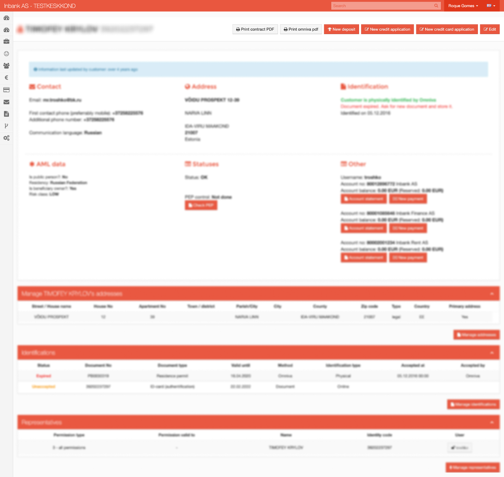
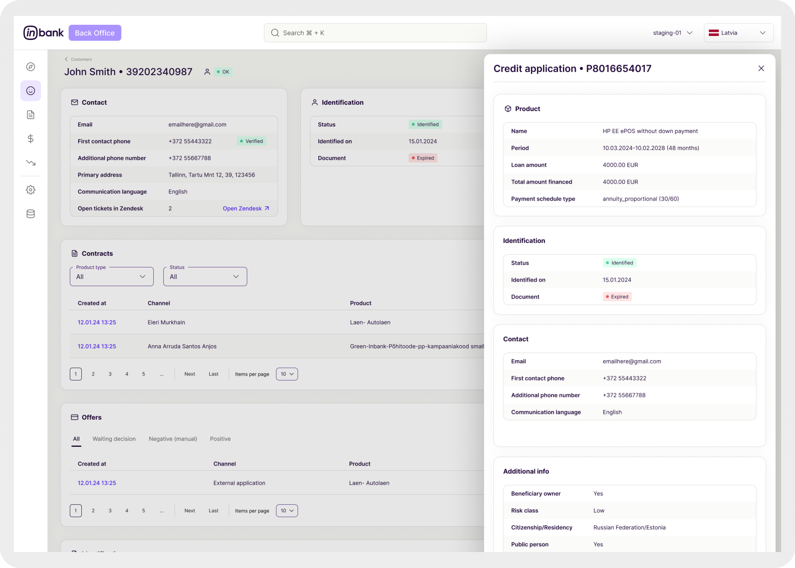

## Overview

Inbank was going through a major 2024 restructuring and product expansion, and their internal Customer Service Back-office could no longer keep up. As the company’s first in-house designer, I led the redesign of this internal tool to support new Hire Purchase products and create a scalable foundation for future growth.

The goal was to transform a fragmented, hard-to-use system into a clear, modular back-office that helps support agents work faster and more confidently while aligning with Inbank’s evolving product strategy.

## The Problem

The existing back-office had been built incrementally over time, without a clear design system or shared structure. This resulted in:

-   Fragmented navigation and inconsistent UI patterns
-   Complex workflows that were hard to learn and easy to misuse
-   No reusable components, slowing down development
-   Increasing product complexity that made scaling risky

Because this tool was used daily by customer support teams, these issues had a direct impact on operational efficiency and onboarding.

This is an example of how it looked at the time. I've blurred a good portion just to be safe I'm not sharing any data., but you can have a good idea.

‍

## My Role

As Senior Product Designer, I owned the project end to end:

-   Auditing and mapping the legacy system
-   Interviewing support agents, team leads, and stakeholders
-   Using Mixpanel data to prioritise high-impact workflows
-   Designing a modular and scalable component system
-   Delivering UX and UI for core backoffice screens
-   Collaborating closely with developers during implementation

This role required strategic thinking, strong UX fundamentals, and continuous alignment with engineering and product.

This is one example of one the mappings I did at the time. I was trying something new.

‍

## Research and Discovery

To understand the full scope, I began by mapping every screen, table, state, and interaction across the existing back-office. This helped identify inconsistencies, bottlenecks, and opportunities to simplify workflows.

I then conducted interviews with:

-   Customer support agents using the tool daily
-   Team leads responsible for monitoring performance
-   Product managers defining requirements
-   Developers maintaining and extending the system

These qualitative insights were complemented by Mixpanel data, which revealed the most frequently used screens and actions. This combination helped prioritise what to redesign first and where clarity and speed mattered most.

## Design Exploration

### Visual direction

Before designing screens, I created a moodboard aligned with Inbank’s new visual identity. This helped set expectations around tone, hierarchy, and UI consistency.

‍

‍

### Iterating on structure

I explored multiple versions of the most critical screens, with a strong focus on:

-   Clear data hierarchy
-   Table usability and scanability
-   Error prevention
-   Speed and efficiency for daily use

Early designs were reviewed with support agents to ensure the layouts matched their mental models and workflows.

### Modular component system

From these explorations, I built a set of reusable components that could adapt to different products and data structures, including:

-   Flexible table layouts
-   Customer data blocks
-   Status indicators and badges
-   Action panels and sidebars
-   Search, filtering, and sorting patterns

This system now serves as the foundation for future backoffice features.

‍

‍

## Collaboration and Delivery

I stayed closely involved throughout development to ensure design quality and consistency:

-   Weekly syncs with developers
-   Reviewing builds and providing feedback
-   Adjusting designs when technical constraints surfaced
-   Refining edge cases and interactions

Several key screens have already been shipped, including flows created specifically for newly launched product lines.

‍

‍

## Results and Impact

The redesigned backoffice delivered clear improvements:

-   Faster workflows through predictable layouts and patterns
-   Easier onboarding for new support agents
-   A shared design system that speeds up future development
-   Better visibility for managers and operational teams
-   Stronger alignment between product, design, and engineering

This project reinforced the importance of applying the same design discipline to internal tools as to customer-facing products.

‍

‍

## What Comes Next

The system continues to evolve, with clear opportunities ahead:

-   Expanding the component library for new use cases
-   Adding telemetry to identify friction points
-   Running usability testing to guide iteration
-   Exploring automation for repetitive support tasks
