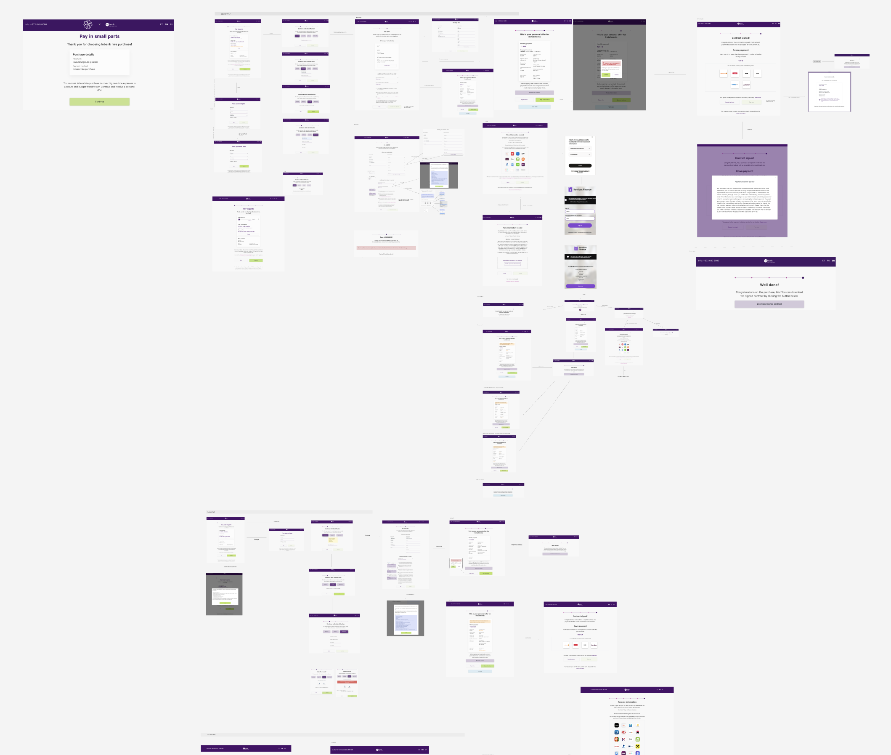
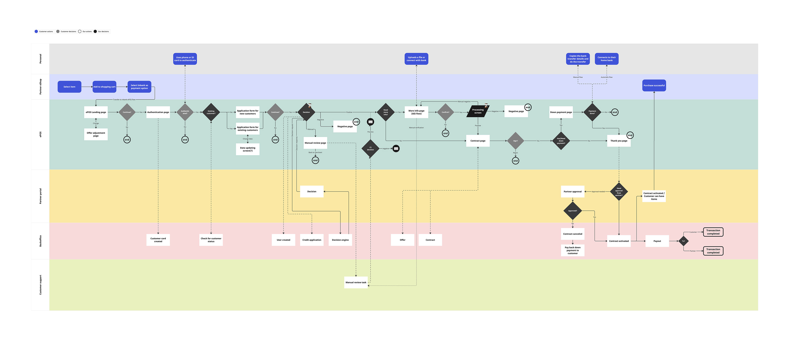
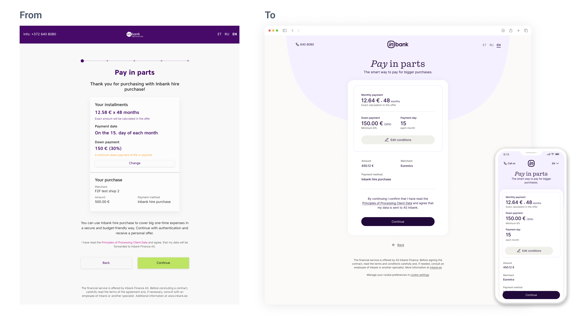
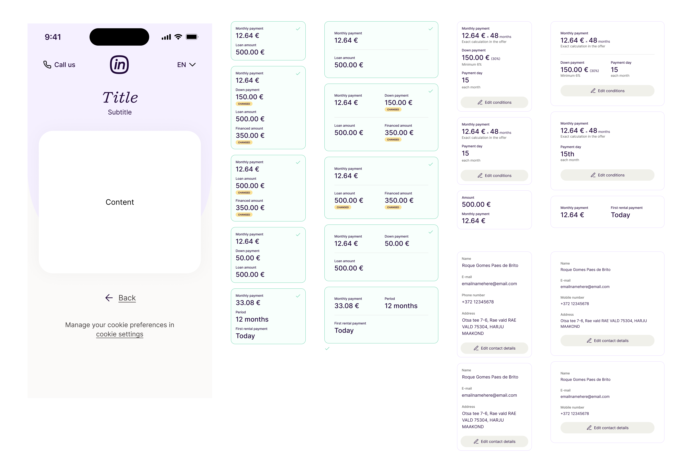
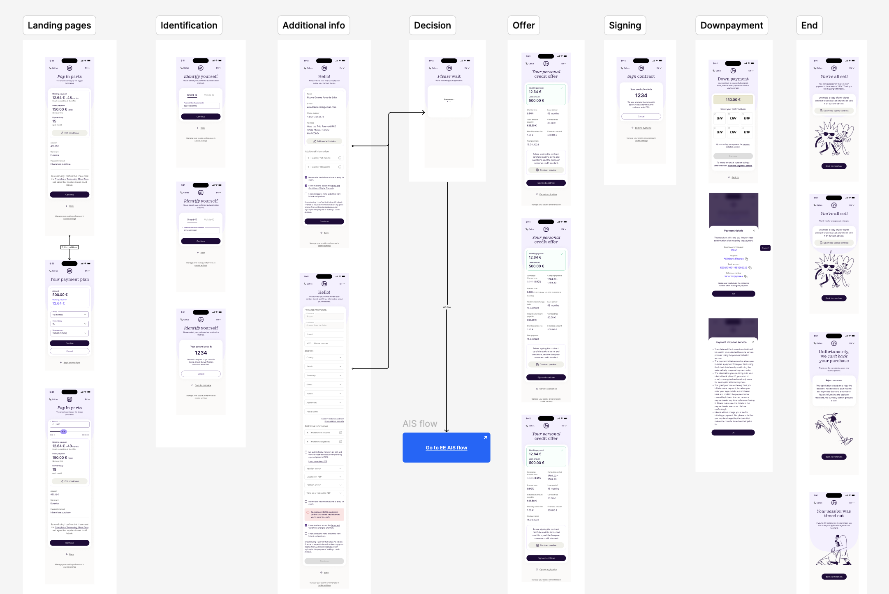
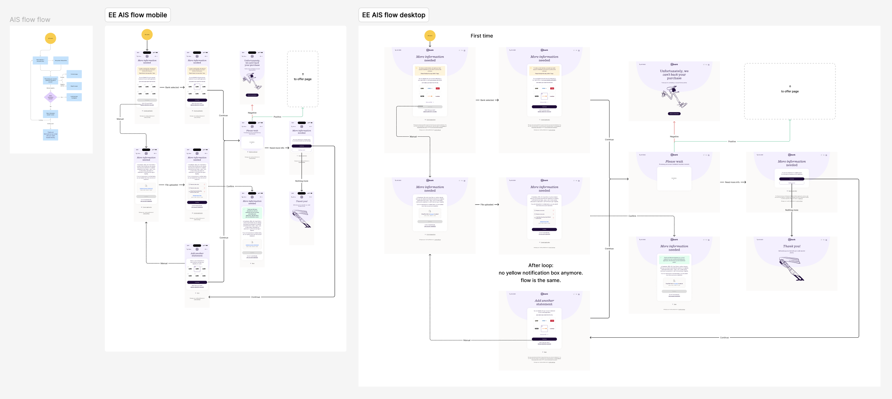
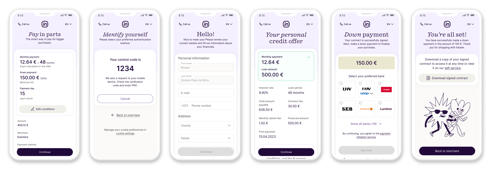

## Overview

Inbank’s Hire Purchase product is a financing solution that allows customers to buy now and pay over time. When I joined Inbank as their first in-house designer, the experience lacked consistency across markets and channels, and there was no unified UX or UI strategy.

I led the redesign of the Hire Purchase flow across both mobile and desktop, with a strong mobile-first focus. The goal was to create a clear, accessible, and scalable experience that works across countries, supports regulatory requirements, and integrates seamlessly with Inbank’s broader design system.

## The Challenge

The Hire Purchase experience spanned multiple systems and stakeholders:

-   Customers applying for financing on merchant sites
-   Identification and verification flows that vary by country
-   Offer generation and acceptance steps
-   Supporting internal and partner-facing systems

The existing experience differed significantly between markets and devices. It suffered from inconsistent layouts, unclear hierarchy, and accessibility gaps, especially on mobile, where most customers completed the flow.

The complexity was driven by:

-   Different legal and compliance requirements per country
-   Multiple identification methods and edge cases
-   Separate flows for new and returning customers
-   The need to support both mobile and desktop experiences

This is how the current flow was mapped before I arrived:

## My Role

As the lead Product Designer, I was responsible for the end-to-end experience:

-   Auditing and mapping the full Hire Purchase journey
-   Designing responsive flows for mobile and desktop, with mobile as the primary focus
-   Improving accessibility, clarity, and usability at every step
-   Collaborating with product managers, analysts, and developers
-   Creating reusable patterns that could scale across markets
-   Contributing components and principles to Inbank’s design system

This required strong system thinking, attention to detail, and close collaboration across disciplines.

## Research and Discovery

I began by mapping the full loan application flow across devices, systems, and actors. This helped surface fragmentation, repetition, and friction points, particularly in mobile flows where space and attention are limited.

I worked closely with product managers and analysts to understand:

-   Country-specific legal constraints
-   Data dependencies and edge cases
-   Differences between new and returning customer journeys

This phase resulted in a shared understanding of the end-to-end flow and clear priorities for simplification and improvement.

## Design Approach

### Rebalancing content and visual hierarchy

For the initial landing and summary screens after customers select Hire Purchase, I redesigned layouts to:

-   Emphasize the most important financial figures
-   Group related information
-   Use stronger, purposeful color for actions that move the user forward

This made the flow clearer and reduced cognitive load for people evaluating financing options.

## Design Approach

Rather than focusing on individual screens, I approached the Hire Purchase experience as a set of flexible, repeatable flows. The goal was to reduce complexity, support variation, and create a clear mental model that works across devices, markets, and user scenarios.

#### Core design principles

The redesign was guided by a small set of principles that informed every decision:

-   **Mobile-first clarity**: Mobile was the primary constraint, ensuring content hierarchy, actions, and forms remain clear under real-world conditions. Desktop layouts scale naturally from the same structure.
-   **Accessibility by default**: Readability, contrast, spacing, focus states, and touch targets were treated as baseline requirements, improving usability for all users.
-   **Flow over screens**: I designed interaction patterns that adapt to different paths, rather than one-off screen solutions.
-   **Consistency with flexibility**: Patterns remain familiar even when logic, data, or regulatory requirements change.

#### Designing adaptable product flows

Instead of separating experiences by specific screens, I focused on defining consistent patterns that support:

-   New and returning customers
-   Multiple identification and verification methods
-   Different offer outcomes and edge cases

This approach keeps the experience predictable while allowing the product logic to vary without fragmenting the UI.

#### Supporting multi-country and regulatory variation

Because legal and compliance requirements differ by country, I designed layouts and interaction models that accommodate local variation within a shared structure. This reduced duplication, simplified development, and made the experience feel coherent across markets.

## Collaboration and Delivery

I worked closely with product, analytics, and engineering throughout the process:

-   Aligning on logic and country-specific requirements
-   Adjusting designs based on technical constraints
-   Reviewing implementations to ensure quality and consistency
-   Refining details and edge cases during development

This collaboration ensured the final experience was both high-quality and technically feasible.

## Results and Impact

The redesigned Hire Purchase experience delivered:

-   A consistent and accessible journey across devices and markets
-   Improved clarity and usability, especially on mobile
-   Reduced friction for returning customers
-   Scalable patterns for future product and market expansion
-   Strong foundations for Inbank’s design system

This work helped transform a complex financial flow into a coherent, user-centered experience.

## Live view

Below is a "live" mockup that I'm developing using Windsurf and Caude. You can also test it here: [https://inbank-loan-app.vercel.app/](https://inbank-loan-app.vercel.app/)

I'll be adding more details to the flow in the next days.

<!-- Webflow Interactive Embed - Improved Desktop View -->
<!-- Paste this entire code into Webflow HTML Embed -->

  <!-- Device Controls -->
  

    <button onclick="switchDevice('mobile')" id="mobileBtn" style="padding: 12px 28px; border: 2px solid #6b46c1; background: #6b46c1; color: white; border-radius: 8px; cursor: pointer; font-size: 15px; font-weight: 600; transition: all 0.2s ease; font-family: -apple-system, BlinkMacSystemFont, 'Segoe UI', sans-serif; display: inline-block !important;">
      📱 Mobile View
    </button>
    <button onclick="switchDevice('tablet')" id="tabletBtn" style="padding: 12px 28px; border: 2px solid #e0e0e0; background: white; color: #333; border-radius: 8px; cursor: pointer; font-size: 15px; font-weight: 600; transition: all 0.2s ease; font-family: -apple-system, BlinkMacSystemFont, 'Segoe UI', sans-serif; display: inline-block !important;">
      📱 Tablet View
    </button>
  

  <!-- Device Container -->
  

    <!-- Device Frame -->
    

      <!-- Notch -->
      

      <!-- Screen -->
      

        <iframe src="https://inbank-loan-app.vercel.app/" style="width: 100% !important; height: 100% !important; border: none !important; display: block !important; position: absolute !important; top: 0 !important; left: 0 !important; right: 0 !important; bottom: 0 !important;" title="Inbank Loan App" frameborder="0" scrolling="auto" allowfullscreen></iframe>
      

      <!-- Home Indicator -->
      

    

  

## What Comes Next

As the product evolves, opportunities include:

-   Expanding reusable components and patterns
-   Adding telemetry to measure drop-off and behavior
-   Running usability and accessibility testing
-   Further optimizing mobile performance and interactions

‍
